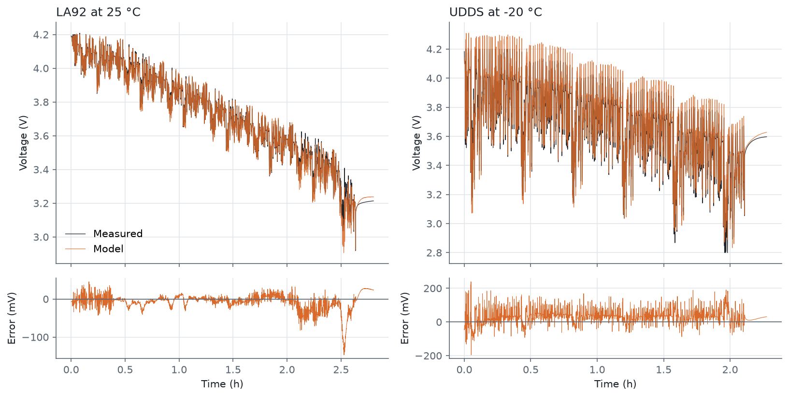
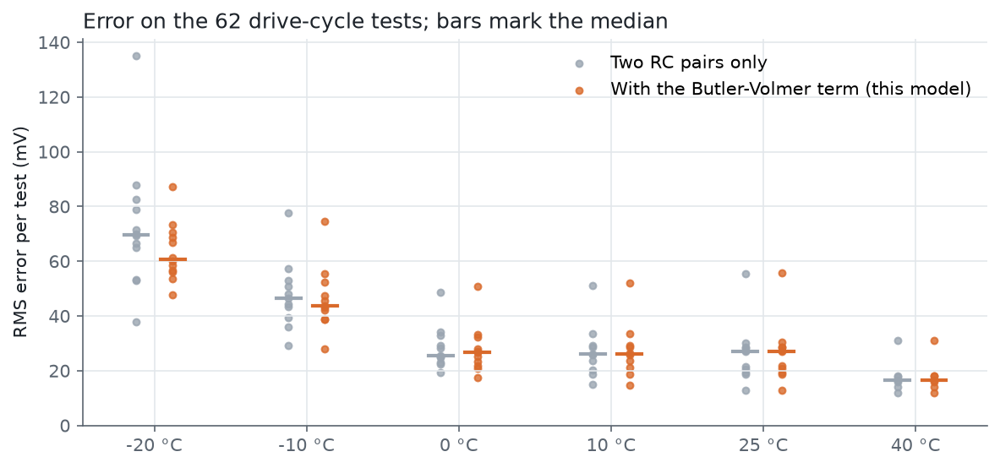
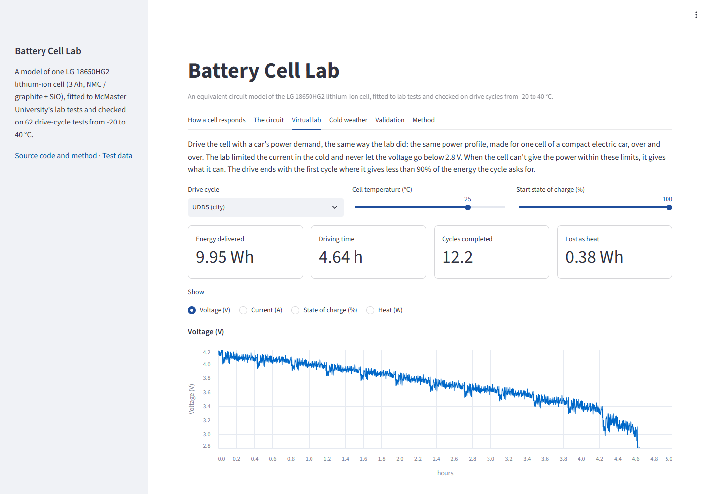
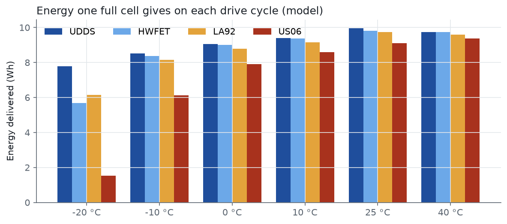

# Battery Cell Lab

[](https://github.com/zero705/battery-cell-lab/actions/workflows/ci.yml)


A model of one lithium-ion cell, the LG 18650HG2 (3 Ah, NMC / graphite + SiO), built from the
public test data of McMaster University. I fitted an equivalent circuit model to the lab's pulse
tests and then checked it on 62 drive-cycle tests from -20 to 40 °C that it never saw while
fitting. You give it a current and a temperature, and it gives you the voltage, the charge left
and the heat. You can also drive it with a car's power demand and see how much energy the cell
gives before it can't keep up. There is a Streamlit app to try all of this.



*Measured voltage (black) and the model (orange) on two drive cycles the model was not fitted
to: LA92 at 25 °C on the left, UDDS at -20 °C on the right.*

## Why

I wanted to see how close a fairly simple circuit model can get to a real cell, and how much
worse it gets in the cold. The McMaster LG HG2 dataset is good for this. It is one new cell
tested at six temperatures, with pulse tests, slow discharges and car drive cycles, and all the
raw files are public.

## Results

Over all 62 tests the median error is **29 mV RMS**. That is less than 1 % of the cell's nominal
voltage of 3.6 V.

<!-- generated: results -->
| Chamber temperature | Tests | Median error, development set | Median error, test set | Median error, all tests | Worst test | Median error, two RC pairs only |
|---|---|---|---|---|---|---|
| -20 °C | 12 | 63.6 mV | 60.0 mV | 60.7 mV | 87.2 mV | 69.7 mV |
| -10 °C | 11 | 45.6 mV | 42.8 mV | 43.6 mV | 74.6 mV | 46.4 mV |
| 0 °C | 11 | 26.6 mV | 26.1 mV | 26.6 mV | 50.7 mV | 25.5 mV |
| 10 °C | 10 | 29.3 mV | 23.8 mV | 26.2 mV | 51.9 mV | 26.1 mV |
| 25 °C | 11 | 27.9 mV | 20.7 mV | 27.0 mV | 55.8 mV | 26.9 mV |
| 40 °C | 7 | 18.0 mV | 15.4 mV | 16.7 mV | 31.1 mV | 16.6 mV |
| **All** | **62** | **29.8 mV** | **28.6 mV** | **29.0 mV** | **87.2 mV** | **29.3 mV** |
<!-- end generated -->

- Each error is the RMS over one whole test, every sample (logged every 0.1 s), from full charge
  to the end of the test, including the rest at the end.
- I made my modelling choices looking only at the Mixed1-4 cycles (development set). The other
  42 tests (test set) I ran once at the end, with the final model. The test set did as well as
  the development set, so the choices didn't just fit those few cycles.
- The last column is the same circuit without the charge-transfer (Butler-Volmer) term. From
  0 °C up the term changes the median by at most 1.1 mV. In the cold it helps: at -20 °C the
  median goes from 69.7 to 60.7 mV, and the worst test from 135 to 87 mV.

Every single test is listed in [docs/method.md](docs/method.md#6-every-test).



### Where it goes wrong

The biggest problem is charging in the cold. In all twelve -20 °C tests the model's voltage is
too high while the cell is being charged by regenerative braking, by 81 to 104 mV on average.
Charging is only 15 % of the time at -20 °C, but 34 % of the squared error comes from it
(medians over the tests). While the cell is discharging, the mean error stays within 20 mV in
eleven of the twelve tests. US06 is the exception, 54 mV low.

I think there are two reasons for this. The fit only sees the cold cell being charged in the
short 10 s pulses of the HPPC test, at most 1.5 A. And the charge-transfer term in the model is
symmetric, it is the same for charge and discharge, which may not be true for a cold cell.

From 10 to 40 °C the error is largest near the end of discharge, where the voltage drops fast.
In 21 of the 28 tests the largest error is in the last tenth of the charge removed.

US06, the cycle with the hardest accelerations, has the largest error at every temperature. On
it the model's voltage is too low while the cell discharges, by 18 to 55 mV on average.

### Checks against the dataset

- The dataset's report gives the 10 s discharge resistance at 50 % state of charge as 179.3,
  89.8, 53.0, 36.7, 27.2 and 23.6 mΩ from -20 to 40 °C. I read the same pulses from the raw
  files, and five of the six match within 0.5 mΩ. At 10 °C I get 38.0 mΩ, 1.3 mΩ higher than
  the report.
- In the cold the lab limited the current, for example to 6 A of discharge at -20 °C. Because of
  this, in the -20 °C US06 test the cell gave only 82 % of the discharge energy the first cycle
  asked for. My virtual lab, with the same demand and the same limits, gives 79 %.
- All 206 files are checked against the SHA-256 hashes that Mendeley publishes.

## Problems I found in the data

I went through all 206 files with `tools/audit_dataset.py`. Most problems are small and easy to
handle, like repeated time stamps or a Wh column that doesn't follow the energy. But eight of the
drive-cycle tests can't be used:

- HWFET at 25 °C has no current at all, the file is just 10 minutes of rest.
- LA92 at 10 °C has time going backwards in four places, and three rows with no values.
- Mixed4 at -10 °C has a 416 s gap in its log early in the drive, while the cycle was running.
  So the charge that moved during the gap is unknown.
- Mixed4 to Mixed8 at 40 °C were actually run at 23 to 24 °C, and stopped after 0.19 Ah.

The dataset also has no Mixed3 at 0 and 10 °C, which leaves 62 tests. Two more things in the
data matter for the model: in the cold the lab limited the current (see above), and at 40 °C
the cell gave less charge than at 25 °C. All of this is in [docs/data.md](docs/data.md).

## The app

```bash
git clone https://github.com/zero705/battery-cell-lab.git
cd battery-cell-lab
pip install -e ".[app]"
streamlit run streamlit_app.py
```



There are six tabs:

- **How a cell responds**: a real current pulse, and what each part of the circuit adds to the
  voltage
- **The circuit**: every fitted parameter against charge and temperature
- **Virtual lab**: drive the cell with a car's power demand, with any cycle, temperature and
  starting charge
- **Cold weather**: the same drive at six temperatures
- **Validation**: every test, measured against the model
- **Method**: a short summary and the data source



At 40 °C the cell gives a bit less energy than at 25 °C on three of the four cycles. This is not
a bug. In this dataset the cell really gave less charge at 40 °C (its C/20 discharge to 2.8 V
removed 2.687 Ah, against 2.779 Ah at 25 °C), and the model follows the data.

## How it works

1. The model is: terminal voltage = open-circuit voltage + R0·i + (2RT/F)·asinh(i/2i0) + two RC
   pairs. The asinh part is a Butler-Volmer charge-transfer term. The RC pairs are a fast one
   (seconds) and a slow one (minutes). All the parameters depend on the charge removed and on the
   temperature, and between the six test temperatures they follow the Arrhenius law (the log of
   each value is linear in 1/T).
2. For the open-circuit voltage I take the shape of the slow C/20 discharge and move it onto the
   voltages at the end of the hour-long rests in the HPPC test. If I leave out one rest point and
   predict it from the others, the error is 8.9 mV RMS. A curve through the rest points alone
   gets 17.8 mV, about twice as much.
3. At every state of charge of the HPPC test (eight pulses, a step and an hour of rest) the
   parameters are fitted to the measured voltage. For each guess of the time constants and i0,
   the resistances are solved exactly with non-negative least squares (variable projection), and
   the search is run from twelve starting points. If the slow time constant comes out longer than
   any rest in the window, it can't really be identified, so that level is not used (3 of 63
   levels).
4. Each drive cycle is run from full charge with its measured current and cell temperature, and
   the predicted voltage is compared with the measured one, sample by sample.

All the equations, and every number of the validation, are in [docs/method.md](docs/method.md).
The dataset and its problems are in [docs/data.md](docs/data.md).

## Limitations

- It is one new cell, so there is nothing about ageing or about differences between cells.
- Charging in the cold is the weakest part (see above).
- Temperature is an input, the model doesn't calculate it. In the lab and cold-weather tabs the
  cell stays at the chosen temperature, while a real cell warms up as it works (by about 2 to
  5 °C in the -20 °C tests). There is no thermal model.
- There is no hysteresis. The open-circuit voltage is the one after discharging, which is fine
  for drives because they mostly discharge.

## Running everything yourself

```bash
pip install -e ".[dev]"
python tools/fetch_dataset.py      # 206 files, 117 MB, each checked against its SHA-256
python tools/audit_dataset.py      # the data problems listed in docs/data.md
python tools/identify_model.py     # fits the model: data/model.json (a few minutes)
python tools/validate_model.py     # all drive cycles: data/validation.json and the traces
python tools/compare_variants.py   # how the model choices were made: data/development.json
python tools/extract_examples.py   # data/pulses.csv for the app
python tools/make_figures.py       # docs/images
python tools/update_docs.py        # the tables in README.md and docs/method.md
pytest --cov                       # 100 % coverage; raw-data tests run once the data is there
ruff check . && ruff format --check . && mypy
```

The app and the tests only need what is in `data/`. The raw data is only needed to rebuild it.
How the app and the scripts are protected, and how to report a security problem:
[SECURITY.md](SECURITY.md).

## Project structure

```
src/celllab/        the model: reading the data, open-circuit voltage, circuit, fitting,
                    validation, virtual lab
streamlit_app.py    the app
data/               the dataset file list, the fitted model, the comparisons behind it,
                    the validation results and the traces the app plots
tools/              scripts to download, check, fit, compare, validate and plot
docs/               method, data and figures
tests/              pytest tests, including the app and every number stated about the data
```

## Data and license

The test data is from P. Kollmeyer, M. Naguib, M. Skells, *LG 18650HG2 Li-ion Battery Data*,
McMaster University, Mendeley Data, V2, 2020, <https://doi.org/10.17632/b5mj79w5w9.2>, licensed
[CC BY 4.0](http://creativecommons.org/licenses/by/4.0). The raw files are not in this repo;
`tools/fetch_dataset.py` downloads them from Mendeley Data. The files in `data/traces/`,
`data/profiles.csv` and `data/pulses.csv`, and the open-circuit voltage curves in
`data/model.json`, are made from that data (resampled, cut, fitted or compared with the model)
and are under the same licence.

The code is under the [MIT license](LICENSE).

## Author

Ömer Faruk Şenol, Hybrid and Electric Vehicles Technology, İnönü University

[GitHub](https://github.com/zero705) ·
[LinkedIn](https://www.linkedin.com/in/%C3%B6mer-faruk-%C5%9Fenol-2778a63b5/)
